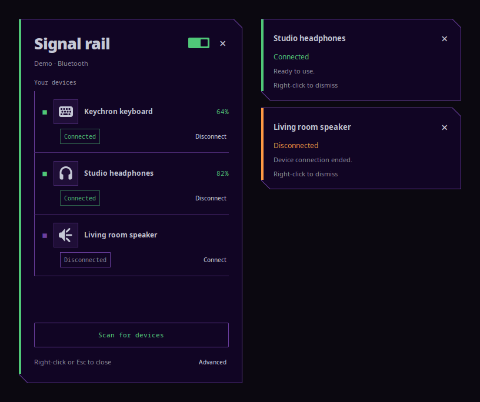

# Signal rail

**A cyberpunk Bluetooth panel for Linux. Your devices, your desktop colors.**



Signal rail is a compact native GTK app for connecting Bluetooth devices, pairing
new ones, and seeing connection events. A vertical status rail, cut corners, and
adaptive colors give it its own style without requiring a particular desktop theme.

- Connect, disconnect, scan, and pair with PIN/passkey confirmation.
- Live connection states and battery levels when the device reports them.
- Connection notifications: **right-click a popup to dismiss it**.
- **Right-click or Esc** closes the main panel without disconnecting devices.
- Automatic desktop colors, four presets, and external JSON palettes.
- No account, cloud service, telemetry, or pip dependencies.

**Early preview:** Linux only, using BlueZ. HyDE, Hyprland, Waybar, Blueman, and
systemd are optional. Windows and macOS are not supported.

## Desktop support

| Environment | Behavior | Validation |
| --- | --- | --- |
| Hyprland | Anchored popup and notification stack | Native UI and live device readback tested |
| Other layer-shell Wayland desktops | Same popup when gtk-layer-shell supports the compositor | Community testing welcome |
| GNOME, KDE, X11, or no layer-shell library | Regular app window; notification placement controlled by desktop | X11 fallback tested in Xvfb; GNOME/KDE sessions not yet tested |

The fallback does not promise identical popup positioning across desktops.
Use `--window` to force it. Notifications use application-owned GTK windows,
not your notification daemon, so right-click dismissal is consistent in the UI.
They are not added to the desktop notification history.

## Install

Requires **Python 3.10+, GTK 3.22+, GLib 2.80+, PyGObject with Cairo, and BlueZ**.
gtk-layer-shell 0.6+ is optional and enables anchored Wayland popups. Use your
distribution's Python and packages rather than a Python virtual environment.

Arch Linux:

```sh
sudo pacman -S python-gobject python-cairo gtk3 bluez bluez-utils gtk-layer-shell
```

Ubuntu 24.04+ / Debian 13+:

```sh
sudo apt install python3-gi python3-gi-cairo gir1.2-gtk-3.0 bluez gir1.2-gtklayershell-0.1
```

Fedora:

```sh
sudo dnf install python3-gobject python3-cairo gtk3 bluez gtk-layer-shell
```

Then install for your user, **without sudo**:

```sh
git clone https://github.com/onepushmain/signal-rail.git
cd signal-rail
/usr/bin/python3 install.py
~/.local/bin/signal-rail
```

Or download the source archive from [Releases](https://github.com/onepushmain/signal-rail/releases),
extract it, and run `install.py`. Open **Signal rail** from your app menu. If
`~/.local/bin` is on your PATH, `signal-rail` also works directly.

The installer respects XDG config/data/state directories, backs up existing files,
and **does not edit your compositor or bar configuration**. It doesn't install
packages, enable Bluetooth, or start background services on your behalf.
Your system's Bluetooth service must be running and the adapter must be unblocked.

Optional session autostart for desktops that honor XDG autostart:

```sh
/usr/bin/python3 install.py --autostart
```

For a standalone compositor, use its startup config instead; examples are below.
Signal rail stays running after you close the panel so it can show device events.
Use `signal-rail --quit` to exit completely.

## Colors

Edit `~/.config/signal-rail/config.json` (or `$XDG_CONFIG_HOME/signal-rail/config.json`).
The default `"theme": "auto"` reads HyDE/Wallbash files when present, otherwise
the GTK theme's named colors, with a built-in fallback. Palette changes reload
within two seconds. Main text gets contrast correction for light and dark palettes.

Available theme values:

| Value | Source |
| --- | --- |
| `auto` | HyDE if available, otherwise GTK colors |
| `system` | GTK colors, ignoring HyDE |
| `hyde` | Waybar `theme.css` and Hyprland `themes/colors.conf` |
| `noir`, `evangelion`, `ice`, `ember` | Built-in presets |
| `custom` | Built-in base plus your supplied palette |

For a wallpaper color generator such as Wallust or Matugen, configure it to emit
a JSON file with `bg`, `fg`, `accent`, `secondary`, and `warning` hex colors. Point
Signal rail at that file; it doesn't run the generator itself:

```json
{
  "theme": "custom",
  "palette_file": "palette.json",
  "notification_seconds": 8,
  "display_mode": "auto",
  "top_margin": 16,
  "right_margin": 20
}
```

Relative palette paths are resolved next to the config. See
[`examples/palette.json`](examples/palette.json). You can also put a `"palette"`
object directly in the config; its values override the file. Values must be six-digit
hex strings. Invalid colors are ignored, never executed as CSS or shell code.

Set `notification_seconds` to `0` for manual dismissal only. At most three event
popups are shown. Set `display_mode` to `window` to disable layer-shell positioning;
restart after changing display mode or margins.

## Optional integrations

- **Waybar:** merge [`examples/waybar.jsonc`](examples/waybar.jsonc) and add
  `bluetooth#signal-rail` to a module list. No icon font is required by the example.
- **Hyprland:** [`examples/hyprland.conf`](examples/hyprland.conf).
- **Sway:** [`examples/sway.conf`](examples/sway.conf).
- **Other desktops:** app menu or a keyboard shortcut running `signal-rail`.
- **systemd user service:** installed but not enabled. Start with
  `systemctl --user daemon-reload` then `systemctl --user start signal-rail.service`.
  Start it before opening the app; stop any manually launched copy first.
  The user manager must have the graphical session's DISPLAY/WAYLAND_DISPLAY environment.

Use one autostart mechanism. Blueman, if installed, is available via **Advanced**
for device removal and other settings; it is not required to connect or pair.

## Commands

```sh
signal-rail                  # toggle the panel
signal-rail --show           # open it
signal-rail --hide           # close it, keep event monitoring
signal-rail --status         # JSON snapshot; standalone invocation exits
signal-rail --daemon         # monitor events with panel initially hidden
signal-rail --quit           # exit completely
signal-rail --demo           # isolated sample devices, no system Bluetooth bus
signal-rail --demo --demo-notify
signal-rail --demo --quit
signal-rail --window         # regular window (when starting a new instance)
signal-rail --version
```

## Update and uninstall

Pull/download a new version, rerun `install.py`, and restart the app. Existing
settings are preserved. To uninstall:

```sh
signal-rail --quit
/usr/bin/python3 install.py --uninstall
```

Stop `signal-rail.service` first if you use it. The uninstaller removes unchanged
managed files, restores files that existed before installation, and preserves
locally modified files. It leaves backup records in the XDG state directory.
Remove any bar/compositor integration you added manually.

## Testing and limitations

See [CONTRIBUTING.md](CONTRIBUTING.md). Unit tests cover connection transitions,
scan cancellation, pairing cancellation, theme parsing, and clean install/uninstall.
Native UI checks use simulated devices and include the regular-window fallback.

Hardware pairing across different device types is still unverified. New pairing
initiated through this app is marked trusted after authentication. Battery display
depends on BlueZ/device support. This app doesn't replace audio routing or device
firmware tools. A working Polkit/session setup may be needed for adapter control.

## License

[MIT](LICENSE). Contributions and desktop compatibility reports are welcome.

Built with [GTK](https://www.gtk.org/), [BlueZ](https://github.com/bluez/bluez), and
optionally [gtk-layer-shell](https://github.com/wmww/gtk-layer-shell).
